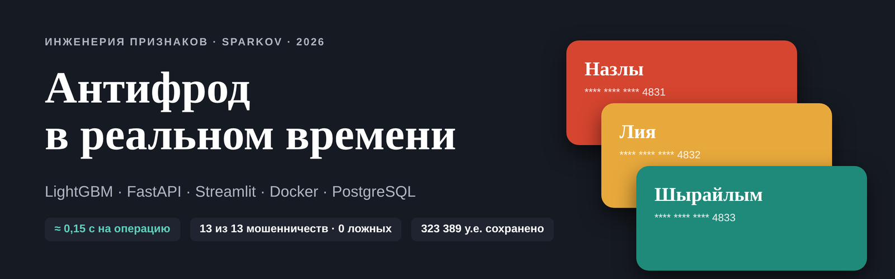
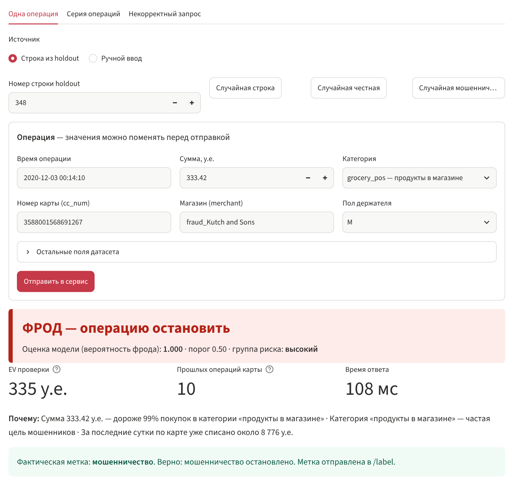
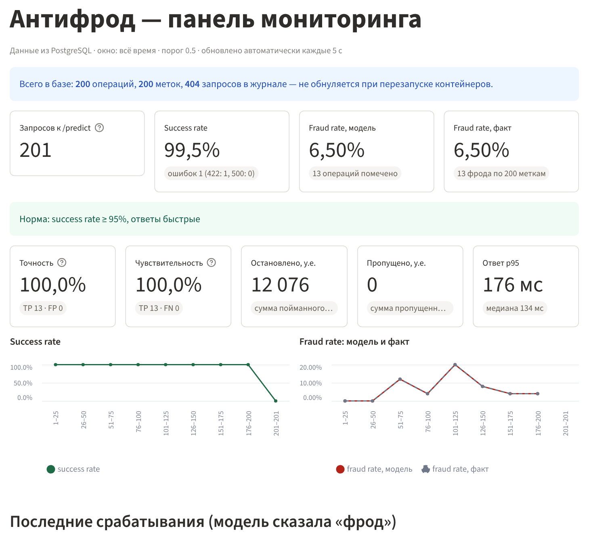
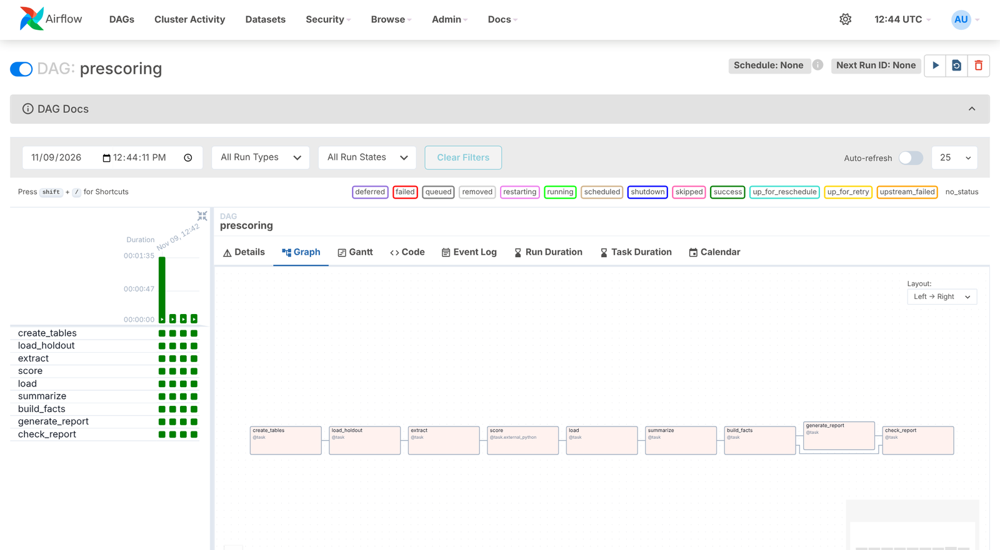
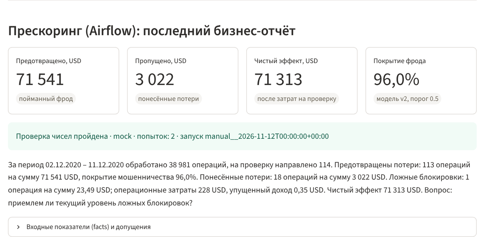
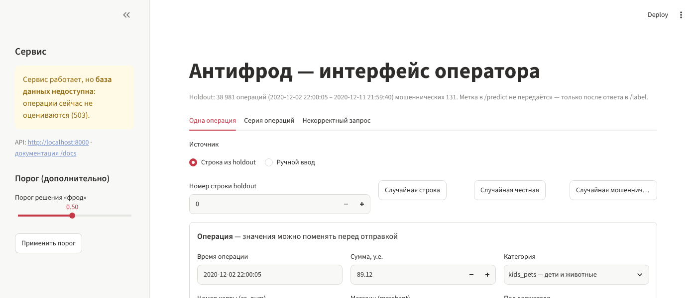
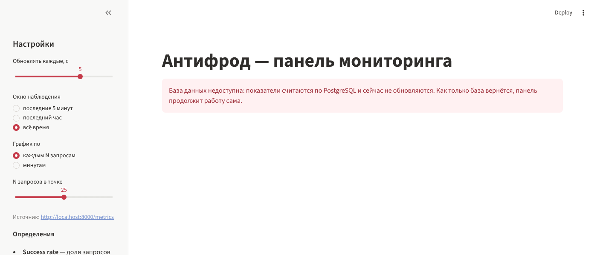
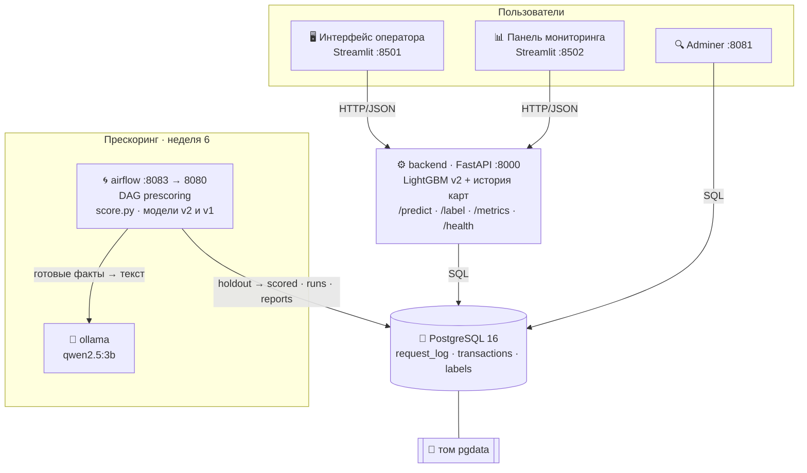

<p align="center">
  
</p>

<p align="center">
  
  
  
  
  
  
  
  
</p>

<p align="center">
  <b>Проект курса «Инженерия признаков»</b> · датасет Sparkov (1,85 млн операций по картам)<br>
  Команда: <b>Назлы</b> · <b>Лия</b> · <b>Шырайлым</b>
</p>

---

Система находит мошеннические операции по банковским картам. Начинали с модели на исторических данных и за шесть недель довели её до работающей системы с двумя режимами:

- **онлайн**: операция приходит по одной, через ≈ 0,15 с выходит решение «фрод / не фрод» с объяснением, каждое решение записывается в PostgreSQL, панель показывает здоровье сервиса и качество модели;
- **прескоринг** (пакетный режим): Airflow по кнопке оценивает всю отложенную выборку, считает финансовые показатели, а компактная языковая модель пишет по ним резюме для руководства. Каждое число в резюме автоматически сверяется с посчитанными данными.

## Главные результаты

| Что | Результат |
|---|---|
| 💰 **Экономия на отложенном периоде** | **323 389 у.е.** — 98,7% от максимума, возможного при лимите аналитиков 0,3% операций в день |
| 🎯 **Качество модели (valid, порог 0,5)** | точность **98,3%**, чувствительность **94,1%** |
| 🔁 **Вторая итерация (v2)** | **+3 462 у.е.** на новом периоде, разрыв между оценкой и фактом сократился с 1,1 до 0,0 п.п. |
| ⚡ **Сервис в реальном времени** | ≈ **0,15 с** на операцию, расхождение с пакетным `score.py` — **0** на 300 операциях |
| 🛡️ **Серия из 200 операций holdout** | поймано **13 из 13** мошеннических, ложных тревог **0** |
| 🐘 **Надёжность** | данные переживают перезапуск; при падении базы ответ 503 за 0,15 с и восстановление без перезапуска |
| 🌀 **Прескоринг 38 981 операции (Airflow)** | предотвращено **71 541 USD** (96,0% суммы фрода), ложных блокировок **1**, чистый эффект **71 313 USD**; повторный запуск — без дубликатов |

## Как это выглядит

<table>
<tr>
<td width="50%"><b>Интерфейс оператора</b> — операция, решение, причины, сверка с фактом<br></td>
<td width="50%"><b>Панель мониторинга</b> — показатели считаются SQL-запросами к PostgreSQL<br></td>
</tr>
</table>

<table>
<tr>
<td width="50%"><b>Airflow</b> — DAG <code>prescoring</code>: 9 задач от создания таблиц до проверенного отчёта<br></td>
<td width="50%"><b>Отчёт прескоринга на панели</b> — <code>GET /reports/latest</code>, проверка чисел пройдена<br></td>
</tr>
</table>

<sub>На снимке панели в поле модели стоит <code>mock</code>: DAG отлаживался на заглушке Ollama (локальный сервер с тем же API) — в среде разработки Ollama недоступна. Числа и проверка настоящие. Подробности — в <a href="reports/week6/last_run.md">артефактах запуска</a>.</sub>

<details>
<summary><b>Что видно, если база данных недоступна</b></summary>
<br>


</details>

## Архитектура



- **Интерфейс и панель не загружают модель и не читают базу**: всё идёт через API сервиса.
- **Порядок старта**: `db` (healthcheck `pg_isready`) → `backend` (healthcheck `/health`) → интерфейс и панель.
- **Данные в именованном томе `pgdata`**: после `docker compose down` / `up` ничего не теряется.
- **Прескоринг не трогает онлайн-контур**: Airflow сам вызывает `score.py` (функция `score_df`) — ту же реализацию признаков, что и сервис, — и пишет в свои таблицы.

## Быстрый старт

Нужен только **Docker Desktop**.

```bash
copy .env.example .env                        # пароли (в git не попадает)
docker compose up -d --build                  # 7 контейнеров
docker compose exec ollama ollama pull qwen2.5:3b   # модель для отчёта, однократно (~2 ГБ)
docker compose ps                             # db, backend, airflow — (healthy)
```

На Windows то же самое делает двойной клик по **`zapusk_docker.bat`**.

| Адрес | Что |
|---|---|
| http://localhost:8501 | интерфейс оператора |
| http://localhost:8502 | панель мониторинга |
| http://localhost:8000/docs | API сервиса (Swagger) |
| http://localhost:8083 | Airflow: пользователь `admin`, пароль `AIRFLOW_ADMIN_PASSWORD` из `.env` (по умолчанию `admin`) |
| http://localhost:8081 | Adminer: PostgreSQL, сервер `db`, логин и пароль из `.env`, база `antifraud` |

> [!NOTE]
> Первый запуск готовит историю карт из исходных CSV Sparkov (`fraudTrain.csv`, `fraudTest.csv`, лежат рядом в `../data`, в репозиторий не входят). Первая сборка образа Airflow и загрузка Ollama занимают 10–20 минут; Docker Desktop лучше выделить не меньше 8 ГБ памяти.

<details>
<summary><b>Полезные команды</b></summary>

```bash
docker compose down                 # остановить; данные остаются в томе pgdata
docker compose down -v              # остановить и УДАЛИТЬ базу
docker compose stop db              # проверить поведение без базы
docker compose start db             # вернуть базу — сервис восстановится сам
docker compose exec db psql -U antifraud -d antifraud   # консоль SQL (или psql_db.bat)
backup_db.bat / restore_db.bat      # резервная копия pg_dump и восстановление
python replay.py --n 200            # прогнать 200 операций holdout из терминала
zapusk_dag.bat                      # запустить DAG prescoring без браузера и показать отчёт
llm_analiz.bat                      # 10 генераций отчёта: доля прошедших проверку чисел
```
</details>

## Путь проекта по неделям

| Неделя | Тема | Что сделали | Итог | Материалы |
|:---:|---|---|---|---|
| **1** | Модель и признаки | 3 блока признаков (профиль клиента, ритм операций, контекст), турнир моделей, тест на утечку для каждого признака, выбор операций по ожидаемым потерям | **323 389 у.е.** — 98,7% от потолка | [отчёт](reports/report.md) · [презентация](presentation/antifraud.pptx) |
| **2** | Вторая итерация | разбор ошибок, карта паттернов мошенничества, блок E «эпизод захвата карты», версия v2, группы риска | **+3 462 у.е.** на fraudTest | [анализ ошибок](reports/week2/3_error_analysis.md) · [слайды](docs/presentations/Неделя2_презентация.pdf) |
| **3** | Реальное время | сервис FastAPI, интерфейс оператора, панель мониторинга, журнал запросов | ответ ≈ 0,2 с, сервис = `score.py` | [слайды](docs/presentations/Неделя3_презентация_с_Docker.pdf) |
| **4** | Docker | Dockerfile, docker-compose, healthcheck, запуск одной командой | `docker compose up` | [слайды](docs/presentations/Неделя3_презентация_с_Docker.pdf) (7–8) |
| **5** | PostgreSQL | контейнер `db`, 3 таблицы, запись каждого запроса, метрики на SQL, поведение при падении базы, Adminer, индексы, бэкап | данные переживают перезапуск | [слайды](docs/presentations/Неделя5_презентация.pdf) |
| **6** | Прескоринг на Airflow | DAG `prescoring`, пакетный скоринг выборки в PostgreSQL, финансовые показатели, отчёт LLM с автоматической проверкой чисел, `/reports/latest` на панели | 71 313 USD чистого эффекта, без дубликатов при повторе | [подробно](docs/weeks/неделя6.md) · [запуск](reports/week6/last_run.md) · [слайды](docs/presentations/Неделя6_презентация.pdf) |

Подробный журнал изменений каждой недели лежит в [`docs/weeks/`](docs/weeks), полная техническая документация — в [`docs/ПОДРОБНО.md`](docs/ПОДРОБНО.md).

## Неделя 6 — прескоринг на Airflow

Онлайн-режим оценивает операцию в момент запроса. **Прескоринг** — пакетный режим: весь набор операций за период оценивается по команде (или расписанию), результаты ложатся в хранилище и идут в аналитику и отчётность. Запуском и контролем занимается оркестратор **Apache Airflow**.

```
create_tables → load_holdout → extract → score → load → summarize → build_facts → generate_report → check_report
└───────────────────── часть 1: прескоринг ─────────────────────┘   └────────── часть 2: бизнес-отчёт ──────────┘
```

| Задача | Что делает |
|---|---|
| `create_tables` | создаёт таблицы `CREATE TABLE IF NOT EXISTS` ([`airflow/dags/sql/tables.sql`](airflow/dags/sql/tables.sql)) |
| `load_holdout` | грузит `data/holdout.csv` в `holdout_transactions`, если таблица пуста (повторно не грузит) |
| `extract` | выгружает выборку во временный CSV, по XCom передаёт **только путь** |
| `score` | отбрасывает `is_fraud`, вызывает `score_df` из `score.py` для v2 и v1 (окружение модели — отдельный venv на Python 3.13) |
| `load` | в одной транзакции: `DELETE` оценок этих версий → `COPY` новых в `scored_transactions` — **идемпотентно** |
| `summarize` | сверяет число оценённых строк с объёмом выборки, пишет запись в `prescoring_runs` |
| `build_facts` | SQL-агрегаты TP/FN/FP и суммы → финансовые показатели → готовые строки `facts` |
| `generate_report` | промпт → Ollama; если в тексте число не из фактов — ещё попытка (до 3), каждая попытка в `llm_attempts` |
| `check_report` | извлекает все числа из текста, сверяет с фактами, сохраняет отчёт в `business_reports` в любом случае |

**Расчёты делает код, языковая модель только излагает.** Она получает уже отформатированные строки («113 операций на сумму 71 541 USD») и должна переписать их без изменений. Отчёт с числом, которого нет во входных данных, помечается `check_passed = false`.

### Финансовые показатели и допущения

| Показатель | Определение | Результат (v2, порог 0,5) |
|---|---|---|
| Предотвращённые потери | TP: фрод, который модель отметила | 113 операций, 71 541 USD |
| Понесённые потери | FN: фрод, который модель пропустила | 18 операций, 3 022 USD |
| Ложные блокировки | FP: честные операции, отмеченные как фрод | 1 операция, 23,49 USD |
| Операционные затраты | срабатывания (TP + FP) × стоимость проверки | 114 × 2 = 228 USD |
| Упущенный комиссионный доход | сумма ложных блокировок × ставка комиссии | 0,35 USD |
| Чистый эффект | предотвращённые − затраты − упущенный доход | **71 313 USD** |
| Покрытие мошенничества | предотвращённые / вся сумма фрода в выборке | **96,0%** |
| Сравнение с v1 (доп.) | те же показатели для прежней версии | 70 663 USD, чистый эффект 70 437 USD |

| Допущение | Значение | Почему так |
|---|---|---|
| Валюта | USD | датасет Sparkov — операции американских карт |
| Стоимость ручной проверки | **2 USD** | ≈ 4–5 минут аналитика при ставке ≈ 25–30 USD/час; в неделе 1 мы брали 3 у.е. вместе со звонком клиенту |
| Комиссия банка | **1,5%** | типичная межбанковская комиссия по картам в США (1,5–2%); банк теряет её, когда блокирует честную покупку |

Допущения меняются без правки кода: **Admin → Variables** в Airflow (`review_cost`, `commission_rate`, а также `threshold`, `llm_model`, `compare_model`). После повторного запуска новые значения сразу видны в отчёте. При удвоении обеих ставок чистый эффект снижается лишь на ≈ 228 USD (до 71 085 USD): у модели очень мало срабатываний и почти нет ложных блокировок, поэтому вывод отчёта не меняется.

### Отказ компонента и идемпотентность

| Ситуация | Что происходит |
|---|---|
| Повторный запуск DAG | `scored_transactions` — по-прежнему 2 × 38 981 строк (v2 + v1): `load` удаляет прежние оценки версии перед записью |
| `docker compose stop ollama` | `generate_report` падает после 2 повторов (по 20 с); выборка, оценки, `prescoring_runs` и факты уже сохранены |
| `docker compose start ollama` → **Clear** на `generate_report` | перезапускаются только `generate_report` и `check_report`; факты берутся из файла или из `prescoring_runs.facts` |

Артефакты последнего запуска (запись `prescoring_runs`, факты, текст отчёта, попытки генерации) — в [`reports/week6/last_run.md`](reports/week6/last_run.md). Промпт целиком, описание таблиц, команды демонстрации и анализ работы языковой модели — в [`docs/weeks/неделя6.md`](docs/weeks/неделя6.md).

## Как модель принимает решение

1. **Признаки по истории карты** (35 штук): насколько сумма выше обычной для клиента и категории, сколько операций и денег было за час и сутки, расстояние до магазина, ночное время, «эпизод захвата карты».
2. **LightGBM + калибровка** дают вероятность мошенничества `p`.
3. **Решение**: `p ≥ 0,5` → «фрод». Порог можно менять без перезапуска (`PUT /threshold`).
4. **Для аналитика** выдаётся группа риска, ожидаемая польза проверки `EV = p·(сумма+5) − 3 − (1−p)·25` и понятные причины («сумма дороже 99% покупок в категории…»).

## API

| Метод | Маршрут | Что делает |
|---|---|---|
| `POST` | `/predict` | оценить одну операцию → `transaction_id`, вероятность, решение, причины |
| `POST` | `/label` | прислать фактическую метку (0/1) для `transaction_id` |
| `GET` | `/metrics?window=5m\|1h\|all` | показатели для панели, считаются SQL-запросами |
| `GET` | `/health` | `ok` / `degraded` (база недоступна) |
| `GET` | `/reports/latest` | последний бизнес-отчёт прескоринга (неделя 6) — его показывает панель |
| `PUT` | `/threshold` | сменить порог решения |

Ошибки: **422** — некорректный вход, **404** — нет такой операции, **503** — база недоступна (решение не принимается, потому что его нельзя было бы записать).

## База данных

| Таблица | Что хранит |
|---|---|
| `request_log` | каждый HTTP-запрос, включая 422 и 503: время, адрес, код ответа, причина ошибки, задержка |
| `transactions` | каждое решение модели: `id UUID`, карта, сумма, категория, оценка, решение, порог, версия модели, вся операция в `payload JSONB` |
| `labels` | фактическая метка, ссылается на `transactions` (внешний ключ), значение только 0/1 |
| `holdout_transactions` | неделя 6: отложенная выборка (поля датасета + `is_fraud`, `transaction_id` = `trans_num`) |
| `scored_transactions` | неделя 6: оценки прескоринга, ключ `(transaction_id, model_version)` |
| `prescoring_runs` | неделя 6: запись на каждый запуск — объём, срабатывания, финансовые показатели, допущения |
| `business_reports` | неделя 6: текст отчёта, входные факты (`JSONB`), модель LLM, результат проверки |
| `llm_attempts` | неделя 6: все попытки языковой модели — для анализа доли прошедших проверку |

Схема создаётся автоматически из [`db/init.sql`](db/init.sql). Готовые запросы для аналитики лежат в [`db/queries.sql`](db/queries.sql). Индексы ускоряют запрос «за последние 5 минут» с 23,7 до **0,19 мс** на 300 тыс. строк.

## Метрики на панели

| Группа | Метрики |
|---|---|
| Здоровье сервиса | запросы к `/predict`, success rate (норма ≥ 95%), ошибки 422/500, время ответа (медиана, p95) |
| Поведение модели | fraud rate модели, число помеченных операций, последние срабатывания |
| Качество (по меткам) | fraud rate по факту, TP / FP / FN, точность, чувствительность, остановлено и пропущено у.е. |
| Тревоги | success rate < 95%, p95 > 1 с, расхождение fraud rate модели и факта > 2 п.п. |

## Структура репозитория

```
├── service/            FastAPI: main.py (маршруты, middleware), db.py (PostgreSQL), scoring.py (онлайн-скоринг)
├── frontend/           Streamlit — интерфейс оператора
├── dashboard/          Streamlit — панель мониторинга
├── db/                 init.sql (схема), queries.sql (готовые запросы)
├── airflow/            неделя 6: Dockerfile, DAG prescoring, SQL-схема, report_lib (факты и проверка чисел), tools
├── src/                признаки, модели, экономика, оценка (недели 1–2)
├── configs/            конфигурации экспериментов и финальных моделей
├── artifacts/          обученные модели v1 (final) и v2 (final_v2)
├── reports/            отчёт, турнир, экономика, анализ ошибок недели 2, артефакты прескоринга (week6)
├── experiments/        скрипты исследований
├── presentation/       презентация недели 1 и генераторы слайдов
├── docs/               документация, презентации всех недель, скриншоты
├── tests/              тесты сервиса
├── train.py · score.py обучение и пакетный скоринг
├── Dockerfile · docker-compose.yml
└── *.bat               запуск, psql, бэкап и восстановление для Windows
```

## Обучение и пакетный скоринг (без Docker)

```bash
python -m pip install -r requirements.txt
python train.py --config configs/final_v2.yaml                 # ≈ 2 мин, создаёт artifacts/
python score.py --input <входной.csv> --output <выход.csv>     # пакетный скоринг
python -m pytest tests                                         # тесты
```

> [!TIP]
> Файл `artifacts/final/history.parquet` (история карт, 77 МБ) в репозиторий не входит: его заново создаёт `python train.py --config configs/final.yaml`.

## Известные ограничения

- История карт хранится в памяти одного процесса backend, поэтому несколько копий сервиса видели бы разные истории.
- `init.sql` срабатывает только на пустом томе. Новая колонка означает `ALTER TABLE` или `down -v` (миграции Alembic не делали).
- Отложенный период — 9 суток fraudTest (02.12–11.12.2020): другого неиспользованного периода в датасете нет. Файл преподавателя кладётся в `data/holdout.csv`, таблица очищается `TRUNCATE holdout_transactions`, и DAG загружает его сам.
- Отчёт прескоринга ретроспективный: он опирается на фактические метки `is_fraud`, которые в реальности приходят с задержкой (расследования, чарджбэки — недели).
- Проверка чисел ловит выдуманные и пересчитанные числа, но не ловит неверный смысл: например, если модель припишет 3 022 USD к предотвращённым потерям, а не к понесённым.

---

<p align="center">
  Сделано командой <b>Назлы · Лия · Шырайлым</b> · 2026
</p>
