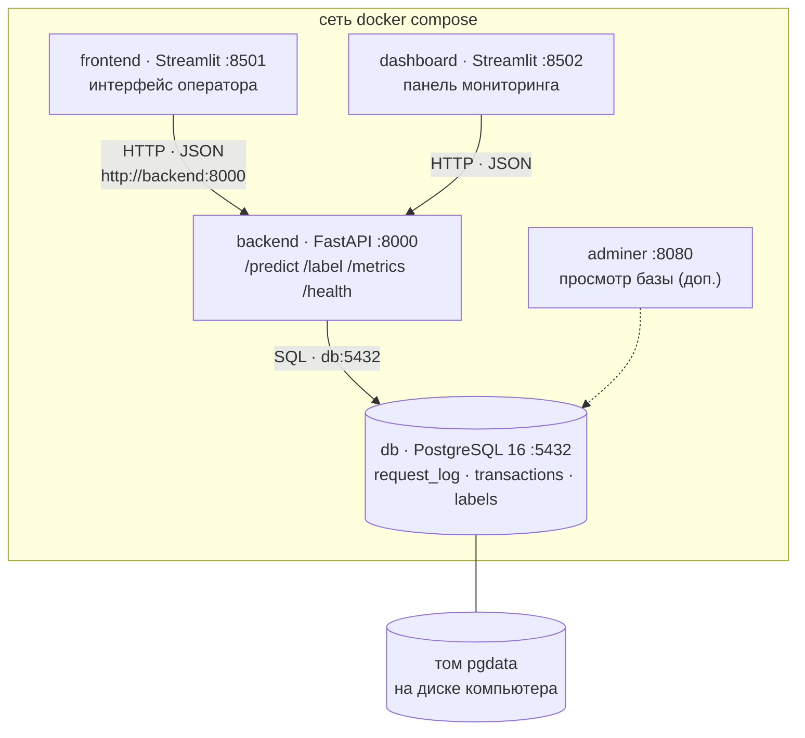

> Полная техническая документация недель 1–5 (прежний README проекта). Краткий обзор всего проекта — в [README](../README.md), неделя 6 — в [weeks/неделя6.md](weeks/неделя6.md).

# 🛡️ Антифрод в реальном времени (+ PostgreSQL)

**Проект курса «Инженерия признаков»** · датасет Sparkov (операции по картам) · команда: A, B, C

Система находит мошеннические операции по картам. Модель — LightGBM с признаками по истории карты.
На неделе 3 модель стала сервисом: операция приходит по одной — решение через ≈ 0,2 с.

| Неделя | Что сделали | Главный результат |
|---|---|---|
| **1** | модель и пакетный скоринг `score.py` | экономия **323 389 у.е.** — 98,7% от возможного при лимите 0,3% проверок в день |
| **2** | разбор ошибок, новые признаки (блок E), версия v2 | **+3 462 у.е.** на новом периоде, расхождение с оценкой 1,1 → 0,0 п.п. |
| **3** | сервис FastAPI + интерфейс оператора + панель мониторинга | ответ ≈ **0,2 с**, сервис = `score.py` (расхождение **0**) |
| **4** | Docker: вся система одной командой | `docker compose up --build` |
| **5** | PostgreSQL: журнал, решения и метки в базе | данные переживают перезапуск контейнеров |

## Быстрый старт (неделя 5, Docker + PostgreSQL)

```
copy .env.example .env
docker compose up -d --build
```

Сервис http://localhost:8000/docs · интерфейс http://localhost:8501 · панель http://localhost:8502 · Adminer http://localhost:8080. Подробно — раздел «Неделя 5» ниже.

## Быстрый старт (неделя 3)

В Docker — одной командой: `docker compose up --build` (подробнее ниже, раздел «Запуск в Docker»). Без Docker:

```
..\.venv\Scripts\python.exe -m pip install -r requirements.txt
..\.venv\Scripts\python.exe -m service.prepare
```

| Окно | Команда | Адрес |
|---|---|---|
| 1 — сервис | `..\.venv\Scripts\python.exe -m uvicorn service.main:app --port 8000` | http://localhost:8000/docs |
| 2 — интерфейс оператора | `..\.venv\Scripts\python.exe -m streamlit run frontend/app.py --server.port 8501` | http://localhost:8501 |
| 3 — панель мониторинга | `..\.venv\Scripts\python.exe -m streamlit run dashboard/app.py --server.port 8502` | http://localhost:8502 |

## Содержание

- [Неделя 5 — PostgreSQL для журнала](#неделя-5--postgresql-для-журнала-сдача-07112026)
- [Неделя 3 — антифрод в реальном времени](#неделя-3--антифрод-в-реальном-времени-сдача-17102026)
- [Неделя 2 — вторая итерация](#неделя-2--вторая-итерация-сдача-10102026)
- [Установка](#установка-один-раз) · [Обучение](#обучение--одна-команда) · [Скоринг](#скоринг--одна-команда) · [Проверки](#проверки) · [Где что лежит](#где-что-лежит)

---

## Неделя 5 — PostgreSQL для журнала (сдача 07.11.2026)

**Что изменилось.** Раньше журнал запросов лежал в SQLite внутри контейнера сервиса и пропадал вместе с ним. Теперь в системе четвёртый контейнер — **PostgreSQL 16**: все запросы (включая ошибочные), решения модели и метки хранятся в базе, в именованном томе `pgdata`. После `docker compose down` и `up` панель показывает те же числа.

### Схема контейнеров



```
frontend :8501 ─┐
                ├─ HTTP/JSON (http://backend:8000) ─► backend :8000 ── SQL (db:5432) ─► db PostgreSQL 16 ── том pgdata
dashboard :8502 ┘                                                                       ▲
                                                                       adminer :8080 ───┘ (доп.)
```

К базе подключается **только backend**. Интерфейс и панель, как и раньше, получают данные через API. Внутри сети compose контейнеры находят друг друга по имени: для backend база — `db:5432`, а не `localhost:5432` (внутри контейнера `localhost` — это сам backend).

### Запуск и остановка

```
copy .env.example .env               # один раз; в .env задать свой пароль (файл не попадает в git)
docker compose up -d --build         # запуск всех контейнеров в фоне
docker compose ps                    # db — healthy, backend — healthy
docker compose logs -f backend       # журнал сервиса
docker compose down                  # остановка; данные в томе pgdata СОХРАНЯЮТСЯ
docker compose down -v               # остановка и удаление тома — ВСЕ данные базы пропадут
```

На Windows то же самое делает `zapusk_docker.bat`: создаёт `.env`, при необходимости готовит данные, запускает и показывает статус.

| Адрес | Что |
|---|---|
| http://localhost:8000/docs | сервис, маршруты |
| http://localhost:8501 | интерфейс оператора |
| http://localhost:8502 | панель мониторинга |
| http://localhost:8080 | Adminer: система PostgreSQL, сервер `db`, пользователь и пароль из `.env`, база `antifraud` |
| localhost:5433 | база для DBeaver / psql с компьютера (5433 — чтобы не конфликтовать с локальным Postgres) |

`psql` внутри контейнера: `docker compose exec db psql -U antifraud -d antifraud` (или `psql_db.bat`).

### Пароль

Пароль хранится в `.env` (в `.gitignore`), в репозитории — только `.env.example` без настоящего пароля. Docker compose подставляет `${POSTGRES_USER}` и `${POSTGRES_PASSWORD}` из `.env` в переменные окружения контейнеров `db` и `backend`; backend получает готовую строку `DATABASE_URL`.

### Таблицы (`db/init.sql`)

`init.sql` Postgres выполняет сам при первом запуске контейнера с **пустым** томом. Если том уже есть, изменения в `init.sql` не применятся — для чистого старта нужен `docker compose down -v` (удаляет данные).

| Таблица | Что хранит | Для чего |
|---|---|---|
| `request_log` | каждый HTTP-запрос: время, маршрут, метод, код ответа, ошибка, задержка | success rate, ошибки, задержка |
| `transactions` | каждую оценённую операцию: id, карта, сумма, категория, магазин, время операции, **операция целиком в `payload` JSONB**, оценка, решение, порог, группа риска, EV, версия модели | fraud rate по модели, лента срабатываний |
| `labels` | фактическая метка из `/label` (`transaction_id` → `transactions.id`) | фактический fraud rate, точность, чувствительность |

Индексы: `request_log (ts)`, `request_log (endpoint, ts)`, `transactions (received_at)`, частичный `transactions (received_at DESC) WHERE is_fraud_pred = 1`, `transactions (card_id)`.

### Как сервис пишет в базу

- **Подключение** — SQLAlchemy + psycopg, создаётся один раз при старте; `pool_pre_ping=True` — после перезапуска базы сервис переподключается сам.
- **Журнал запросов** пишется в **middleware**: запрос с ошибкой 422 FastAPI отклоняет до функции `predict`, а middleware видит каждый запрос и ответ. Запись журнала в `try`: если база упала, клиент всё равно получает ответ.
- **Решение** (`/predict`) — строка в `transactions`; **метка** (`/label`) — строка в `labels` (повторная метка обновляет старую).
- **SQL только с параметрами** (`:amount`, `:id`) — без склейки строк, защита от SQL-инъекций.
- **`/metrics`** считает всё SQL-запросами к базе; окно наблюдения — `?window=5m | 1h | all`.

### Если база недоступна

| Что | Поведение |
|---|---|
| `GET /health` | `{"status": "degraded", "db": "down", ...}` — проверка `SELECT 1` |
| `POST /predict` | **503** «База данных недоступна: решение не записано в журнал, операция не оценена». **Решение команды:** без записи в журнал решение не выдаём — банку нужен след каждого решения для жалоб и расследований. История карты в этом случае тоже не меняется |
| `POST /label`, `GET /metrics` | 503 с понятным текстом |
| Интерфейс / панель | показывают сообщение «База данных недоступна», серия операций останавливается |
| Журнал | запросы, пришедшие во время отказа, в `request_log` не попадают (базы нет), но клиенту отвечают |
| После `docker compose start db` | всё работает дальше **без перезапуска backend** |

### Полезные SQL-запросы

Все — в `db/queries.sql`.

```sql
-- сколько операций в базе и сколько помечено как фрод
SELECT count(*) AS operations, sum(is_fraud_pred) AS flagged FROM transactions;

-- success rate за последние 5 минут
SELECT avg((status_code < 400)::int) AS success_rate, count(*) AS requests
FROM request_log WHERE endpoint = '/predict' AND ts > now() - interval '5 minutes';

-- fraud rate по модели и фактический
SELECT avg(t.is_fraud_pred) AS fraud_rate_model, avg(l.is_fraud) AS fraud_rate_actual, count(l.is_fraud) AS labeled
FROM transactions t LEFT JOIN labels l ON l.transaction_id = t.id;

-- операции дороже 500 у.е., помеченные как фрод за последние 10 минут
SELECT count(*) FROM transactions
WHERE is_fraud_pred = 1 AND amount > 500 AND received_at > now() - interval '10 minutes';
```

### Дополнительно

- **Adminer** — контейнер для просмотра базы в браузере (:8080).
- **История карт для признаков переживает перезапуск**: при старте backend дописывает к стартовой истории все операции из `transactions.payload`, поэтому признаки «по истории карты» после перезапуска считаются так же, как до него.
- **Индексы и EXPLAIN.** На 300 000 строк в `request_log` запрос success rate за 5 минут: с индексом `request_log (ts)` — *Index Scan*, **0,19 мс**; без индексов — *Parallel Seq Scan*, **23,7 мс** (в 120 раз дольше). Проверка: последний запрос в `db/queries.sql`.
- **Резервная копия:** `backup_db.bat` → `docker compose exec db pg_dump -U antifraud -d antifraud -Fc -f /backups/antifraud.dump` (файл в папке `backups/`); восстановление — `restore_db.bat` → `pg_restore --clean --if-exists`.

### Проверки

- `tests/test_service.py` — 5 тестов на живой PostgreSQL: `/health` с базой, запись в `transactions` и `labels`, 422 в `request_log`, `/metrics` = `count(*)` в базе, 404 для неизвестной метки. Запуск: `docker compose up -d db`, затем `DATABASE_URL=postgresql+psycopg://antifraud:<пароль>@localhost:5433/antifraud python -m pytest tests/test_service.py -q`.
- Проверено вручную: остановка базы → `/health` degraded, `/predict` 503 за 0,15 с; запуск базы → работа без перезапуска backend; перезапуск backend → `/metrics` показывает те же числа, история карт восстановлена из базы.

### Ограничения

- Пока база недоступна, операции не оцениваются (осознанный выбор, см. выше).
- `request_log` растёт на каждый запрос, включая опросы панели каждые 5 с. При 10 млн строк первым замедлится расчёт рядов графика и перцентилей задержки по окну «всё время»; помогут индексы по `(endpoint, ts)`, окно 5 минут / 1 час, секционирование по времени и периодическая агрегация.


## Неделя 3 — антифрод в реальном времени (сдача 17.10.2026)

Модель v2 стала сервисом: операция приходит по одной, решение — сразу. Кратко, что сделано и как запустить: [`docs/weeks/неделя3.md`](weeks/неделя3.md).

| Часть | Технология | Что делает |
|---|---|---|
| Интерфейс оператора | Streamlit, порт 8501 | ввод операции, строка из holdout, серия операций |
| Панель мониторинга | Streamlit, порт 8502 | success rate, fraud rate, графики, срабатывания |
| ⬇ HTTP / JSON ⬇ | | |
| **Сервис скоринга** | **FastAPI, порт 8000** | `/predict`, `/label`, `/metrics`, `/health` |
| ⬇ внутри сервиса ⬇ | | |
| Модель v2 + код признаков `score.py` | LightGBM | загружается один раз при старте |
| История карт | словарь в памяти | `{cc_num: прошлые операции}` |
| Журнал | SQLite | `logs/journal.sqlite` — каждый запрос |

Интерфейс и панель не загружают модель и не читают журнал — только запросы к сервису.

### Запуск (Windows, из папки проекта; три окна терминала)

```
..\.venv\Scripts\python.exe -m pip install -r requirements.txt
..\.venv\Scripts\python.exe -m service.prepare          # один раз: data/holdout.csv и стартовая история карт

# окно 1 — сервис, документация на http://localhost:8000/docs
..\.venv\Scripts\python.exe -m uvicorn service.main:app --port 8000
# окно 2 — интерфейс оператора, http://localhost:8501
..\.venv\Scripts\python.exe -m streamlit run frontend/app.py --server.port 8501
# окно 3 — панель мониторинга, http://localhost:8502
..\.venv\Scripts\python.exe -m streamlit run dashboard/app.py --server.port 8502
# по желанию, окно 4 — серия операций из терминала
..\.venv\Scripts\python.exe replay.py --n 150 --start 0
```

На Linux/macOS то же без `..\.venv\Scripts\`: `uvicorn service.main:app --port 8000`, `streamlit run frontend/app.py --server.port 8501`, `streamlit run dashboard/app.py --server.port 8502`. Сервис стартует 10–20 с: загружает модель и историю карт (1,7 млн операций).

### Запуск в Docker (одной командой)

Нужен Docker Desktop. Из папки проекта:

```
docker compose up --build
```

Поднимутся три контейнера из одного образа (`Dockerfile`, Python 3.13 + LightGBM):

| Контейнер | Что | Адрес |
|---|---|---|
| `service` | FastAPI + модель v2 | http://localhost:8000/docs |
| `frontend` | интерфейс оператора | http://localhost:8501 |
| `dashboard` | панель мониторинга | http://localhost:8502 |

- Интерфейс и панель обращаются к сервису по внутренней сети Docker (`http://service:8000`), в браузере ссылки ведут на `localhost:8000`.
- Интерфейс и панель стартуют только после того, как сервис ответит на `/health` (healthcheck).
- Папки `data/` и `logs/` подключены томами: holdout и история карт берутся с компьютера, журнал SQLite остаётся после остановки.
- Если ещё нет `data/cache/service_history.parquet`: `docker compose --profile prepare run --rm prepare` (берёт `fraudTest.csv` из соседней папки `../data`).
- Серия из терминала: `docker compose exec service python replay.py --n 150`.
- Остановить: `Ctrl+C` или `docker compose down`.

Проверено: образ собирается, `/health` отвечает, интерфейс отправляет операции в сервис, панель получает `/metrics` — та же цепочка, что без Docker.

### Маршруты API

| Маршрут | Что делает | Ответ |
|---|---|---|
| `POST /predict` | одна операция — строка датасета Sparkov без `is_fraud` | `transaction_id`, `fraud_score`, `is_fraud_pred`, `threshold` + `risk_level`, `expected_value`, `reasons`, `card_history`, `latency_ms` |
| `POST /label` | фактическая метка: `transaction_id`, `is_fraud` | подтверждение; 404, если такой операции не было |
| `GET /metrics` | данные для панели (`?bucket=50` — размер точки графика) | сводка, ряды по запросам и по минутам, последние срабатывания и ошибки, тревоги |
| `GET /health` | сервис жив, модель загружена | `{"status": "ok", ...}` |
| `PUT /threshold` | смена порога без перезапуска (дополнительно) | старый и новый порог |
| `POST /session/new` | начать счёт показателей заново (дополнительно) | номер сессии |

Некорректный вход (нет поля, текст вместо числа, неизвестная категория, отрицательная сумма) FastAPI отклоняет с кодом **422**; такой запрос пишется в журнал со статусом «ошибка» и снижает success rate. Если упадёт модель — код **500**, тоже в журнал.

### Принятые решения

- **Тот же код, что `score.py`.** Признаки модели v2 считаются по истории одной карты и по таблицам, выученным на train. Сервис берёт прошлые операции карты, дописывает новую и вызывает `src.pipeline.compute`. Сверка: `python -m service.check_batch --n 300` — расхождение с пакетным `score_frame` **0** на 300 операциях из 300.
- **История карт — словарь в памяти** `{cc_num: прошлые операции}`. Стартовая история — fraudTrain + fraudTest до начала holdout, без меток (`data/cache/service_history.parquet`). Каждая операция, пришедшая в сервис, дописывается к своей карте. После перезапуска операции сессии теряются, стартовая история остаётся.
- **Порог 0,5** по откалиброванной вероятности: «мошенничество вероятнее, чем нет». На valid: точность 98,3%, чувствительность 94,1%. Меняется через `PUT /threshold`. Группа риска недели 2 (≥ 0,9 / 0,1–0,9 / < 0,1) и EV возвращаются для оператора. Лимит 0,3% проверок в сутки из недель 1–2 — это суточная очередь аналитиков, а не решение по одной операции; в сервисе его нет.
- **Журнал — SQLite** `logs/journal.sqlite`: время, операция, оценка, решение, порог, статус, код ошибки, время ответа, метка. Переживает перезапуск; панель считает показатели по текущей сессии.
- **Стек — Streamlit** для интерфейса и панели: команда пишет на Python, Streamlit не требует JS и CORS, автообновление панели — `@st.fragment(run_every="5s")`. HTML/CSS дал бы больше свободы в оформлении, но потребовал бы JavaScript (`fetch`, `setInterval`); `CORSMiddleware` в сервисе всё равно включён.

### Holdout

Отложенного периода, не использованного ни в обучении, ни в сравнении версий, не осталось: fraudTrain ушёл на train/valid/holdout, fraudTest — на сравнение v1/v2 недели 2. По ТЗ такой период выдаёт преподаватель — тогда `python -m service.prepare --holdout-file <файл>`. До этого `data/holdout.csv` — 9 суток fraudTest: **02.12.2020 22:00 – 11.12.2020 22:00, 38 981 операция, 131 мошенническая**. На них модель не обучалась и ничего не настраивалось. Начало 22:00 выбрано, чтобы в первой серии из 200 операций была вечерняя волна мошенничества (13 операций): при доле фрода 0,3% в случайных 200 операциях в среднем меньше одной.

### Определения на панели

| Показатель | Как считается | Что показывает |
|---|---|---|
| Success rate | запросы к `/predict` без ошибки / все запросы к `/predict` | работает ли сервис (не качество модели) |
| Fraud rate, модель | операции с `is_fraud_pred = 1` / успешно обработанные | сколько модель останавливает; известен сразу |
| Fraud rate, факт | `is_fraud = 1` / операции, для которых пришла метка | сколько фрода было на самом деле; известен позже |

Два fraud rate различаются из-за ошибок модели (ложные тревоги FP поднимают модельный, пропуски FN — фактический) и потому, что метки приходят не для всех операций и с задержкой. Дополнительно на панели: точность и чувствительность по размеченным, суммы остановленного и пропущенного фрода, время ответа (медиана и p95), тревога при success rate < 95%.

### Проверки

```
..\.venv\Scripts\python.exe -m pytest tests/test_service.py -q     # 5 тестов: health, predict+label, 422 в журнале, 404, порог
..\.venv\Scripts\python.exe -m service.check_batch --n 300         # сервис = score.py
```

Прогон 150 операций holdout с начала (`replay.py --n 150`): 11 мошеннических, все 11 помечены, ложных тревог 0; время ответа ≈ 0,2 с (медиана), ≈ 0,3 с (p95).

### Известные ограничения

- Одна операция считается ≈ 0,2 с: признаки пересчитываются по всей истории карты (до ~2 000 операций). Для потока в тысячи операций в секунду признаки нужно хранить инкрементально.
- История сессии живёт в памяти одного процесса: при перезапуске теряется, при нескольких копиях сервиса — не общая.
- Операции нужно подавать по времени: операция «из прошлого» видит только более раннюю историю карты, но уже поданные более поздние операции не пересчитываются.
- Лимит 0,3% проверок в сутки в сервисе не применяется: решение по порогу.


## Неделя 2 — вторая итерация (сдача 10.10.2026)

Кратко, что изменено и где что лежит: [`docs/weeks/неделя2.md`](weeks/неделя2.md).

Сейчас в репозитории две версии. Обе запускаются одним и тем же `score.py`: интерфейс и колонки выхода прежние.

| Версия | Что это | Артефакты | Конфиг |
|---|---|---|---|
| **v2 (текущая)** | v1 + блок E «эпизод захвата карты» (3 признака) | `artifacts/final_v2/` | `configs/final_v2.yaml` |
| v1 (неделя 1, защищена 03.10) | как сдавали | `artifacts/final/` | `configs/final.yaml` |

```
# v2 — по умолчанию
.venv\Scripts\python.exe score.py --input <входной_csv> --output <выходной_csv>

# v1 — те же файлы кода, артефакты недели 1 (выход побайтно совпадает с кодом по тегу v1-week1)
.venv\Scripts\python.exe score.py --input <входной_csv> --output <выходной_csv> --artifacts artifacts/final

# v1 — ровно код недели 1, в отдельной папке
git worktree add ..\antifraud_v1 v1-week1
cd ..\antifraud_v1
..\antifraud\.venv\Scripts\python.exe score.py --input <входной_csv> --output <выходной_csv>
```

При каждом запуске `score.py` печатает сводку **по группам риска** (замечание преподавателя): высокий (p ≥ 0,90, «точно мошенник»), средний (0,10–0,90), низкий (p < 0,10) — сколько операций в группе и сколько отправлено аналитикам. Если во входном файле есть `is_fraud`, печатается сверка: «мошеннических N, из них в группе высокий / средний / низкий». Метки при этом в расчёте не участвуют. Флаг `--risk-report <файл>` пишет группу каждой операции в отдельный файл. Колонки основного выхода прежние.

**Лимит 0,3% — это ≈ 7 проверок в день, а не 7 аналитиков.** Формула выбора: `EV = p · (сумма + 5) − 3 − (1 − p) · 25`. «Потолок» 327 812 у.е. на holdout — столько спас бы оракул, знающий ответы, при том же лимите. Расчёт по слагаемым — в `reports/week2/1_remarks.md`.

Переобучить v2: `.venv\Scripts\python.exe train.py --config configs/final_v2.yaml` (≈ 2 мин).

**Документы недели 2** — `reports/week2/`:

| Файл | Раздел ТЗ |
|---|---|
| `1_remarks.md` | 3 — ответы на замечания преподавателя (группы риска, PR, баланс, лимит, 328, LogReg) |
| `2_pattern_map.md` | 4, шаг 1 — карта паттернов |
| `3_error_analysis.md` | 4, шаг 2 — анализ ошибок (**основной документ**) |
| `4_solution_evaluation.md` | 5 — оценка решения для инженера сопровождения |
| `5_sens_spec.md` | 6 — чувствительность и специфичность |
| `6_comparison.md` | 7 — v1 против v2 на fraudTest |
| `tables/` | все таблицы, графики и построчные просмотры, которые делают скрипты |
| `presentation/week2.pptx` | презентация на 5–10 минут |

**Главное:**

- Мошенничество в данных — один устойчивый сценарий: двухсуточный захват карты.
- Модель узнаёт его почти всегда. 98% упущенных денег — это узнанные операции, которые не поместились в лимит 0,3%.
- На приёмке (fraudTest, 194 дня) v2 даёт 833 947 у.е. против 830 484 у v1: +3 462, 90% интервал [+55; +7 287].
- Расхождение между своей оценкой и приёмкой сократилось с −1,1 до 0,0 п.п. доли от лучшего возможного.

**Воспроизвести неделю 2** (нужны `data/fraudTrain.csv` и `data/fraudTest.csv`):

```
.venv\Scripts\python.exe -m experiments.w2_patterns                 # эпизоды и карта паттернов (fraudTrain)
.venv\Scripts\python.exe -m tests.test_no_future_leak --block e     # тест на утечку нового блока
.venv\Scripts\python.exe -m src.evaluate --config configs/final_v2.yaml --add e_h_since_big e_big_48h e_usual_ratio e_usual_48h e_night_48h e_amt_48h_log e_cats_48h e_big_rate_hist
.venv\Scripts\python.exe -m src.evaluate --config configs/final_v2.yaml
.venv\Scripts\python.exe -m src.evaluate --config configs/final_v2.yaml --holdout
.venv\Scripts\python.exe train.py --config configs/final_v2.yaml
.venv\Scripts\python.exe -m experiments.w2_errors                   # ошибки v1 + контроль регрессий v2
.venv\Scripts\python.exe -m experiments.w2_raw_scores --config configs/final.yaml
.venv\Scripts\python.exe -m experiments.w2_raw_scores --config configs/final_v2.yaml
.venv\Scripts\python.exe -m experiments.w2_calibration
.venv\Scripts\python.exe -m experiments.w2_sens_spec --version final
.venv\Scripts\python.exe -m experiments.w2_sens_spec --version final_v2
.venv\Scripts\python.exe -m experiments.w2_block
# приёмка — один раз, после заморозки v2:
.venv\Scripts\python.exe score.py --input data/fraudTest.csv --output data/cache/scored_v1_test.csv --artifacts artifacts/final
.venv\Scripts\python.exe score.py --input data/fraudTest.csv --output data/cache/scored_v2_test.csv
.venv\Scripts\python.exe -m experiments.w2_compare
.venv\Scripts\python.exe -m experiments.w2_patterns --test
.venv\Scripts\python.exe -m experiments.w2_sens_spec --version final --scored data/cache/scored_v1_test.csv --tag test
.venv\Scripts\python.exe -m experiments.w2_sens_spec --version final_v2 --scored data/cache/scored_v2_test.csv --tag test
.venv\Scripts\python.exe -m experiments.w2_block --scored-v1 data/cache/scored_v1_test.csv --scored-v2 data/cache/scored_v2_test.csv --tag test
.venv\Scripts\python.exe -m experiments.w2_stress --artifacts artifacts/final_v2 --tag v2
.venv\Scripts\python.exe -m experiments.w2_remarks                  # расчёты к замечаниям: группы, PR-кривая, баланс, 328
.venv\Scripts\python.exe -m tests.test_score_robustness --skip-load --artifacts artifacts/final_v2
```

Ниже — описание недели 1. Оно не менялось, кроме двух строк про fraudTest в конце.

## Установка (один раз)

Python 3.14, Windows. Версии библиотек зафиксированы, seed = 42.

```
python -m venv .venv
.venv\Scripts\python.exe -m pip install -r requirements.txt
```

Положить `fraudTrain.csv` (и для недели 2 — `fraudTest.csv`) в `data/`.

## Обучение — одна команда

```
.venv\Scripts\python.exe train.py --config configs/final.yaml
```

≈ 1 минута при первом запуске (считаются и кэшируются признаки), потом ≈ 15 секунд. Результат — `artifacts/final/`.

## Скоринг — одна команда

```
.venv\Scripts\python.exe score.py --input <входной_csv> --output <выходной_csv>
```

- Вход — та же структура, что `fraudTrain.csv`, без `is_fraud`; порядок строк любой.
- Выход: `trans_num, fraud_probability, decision, reason_1, reason_2, reason_3` (причины — только у `decision = 1`).
- Модель не переобучается, в сеть не ходит. 550 000 строк — 32 с, 2 ГБ памяти.

## Проверки

```
.venv\Scripts\python.exe -m tests.test_no_future_leak --block a      # тест на утечку (a, b, c, base)
.venv\Scripts\python.exe -m tests.test_leak_canary                   # тест ловит заведомые утечки
.venv\Scripts\python.exe -m tests.test_score_robustness              # score.py: 11 проверок + нагрузка
```

## Воспроизвести исследование

```
.venv\Scripts\python.exe -m src.eda                                  # разведка (только train)
.venv\Scripts\python.exe -m src.evaluate --config configs/baseline_ev.yaml
.venv\Scripts\python.exe -m src.evaluate --config configs/a.yaml --add a_cat_bits a_time_bits ...
.venv\Scripts\python.exe -m experiments.c_experiments
.venv\Scripts\python.exe -m experiments.tournament
.venv\Scripts\python.exe -m experiments.scenarios
.venv\Scripts\python.exe -m src.evaluate --config configs/final.yaml --holdout
.venv\Scripts\python.exe -m experiments.economics_report
.venv\Scripts\python.exe -m experiments.build_feature_map
.venv\Scripts\python.exe -m experiments.examples
```

Каждый прогон дописывается в `reports/experiments.csv`.

## Где что лежит

| Путь | Что |
|---|---|
| `reports/report.md` | отчёт (до 5 страниц) |
| `reports/feature_map.md`, `.csv` | карта признаков: гипотеза, вклад в у.е., тест на утечку, отличие от типичного решения |
| `reports/decision_log.md` | журнал решений |
| `reports/tournament.md` | турнир: наборы признаков × модели |
| `reports/scenarios.md` | кто какой сценарий ловит |
| `reports/economics.md` | экономика на холдауте, стресс-тест, сколько аналитиков |
| `reports/examples.md` | реальные карточки для аналитика |
| `presentation/antifraud.pptx` | презентация с заметками |
| `presentation/cheatsheet.md` | шпаргалка к защите |
| `src/features/profile.py`, `velocity.py`, `context.py` | блоки A, B, C |
| `src/economics.py` | стоимость, лимит, политики выбора |
| `tasks/TASK_*.md`, `CLAUDE.md` | исходные задания |

`data/fraudTest.csv` на неделе 1 не использовался. На неделе 2 он открыт один раз, после заморозки v2, для приёмки обеих версий (`reports/week2/6_comparison.md`).
