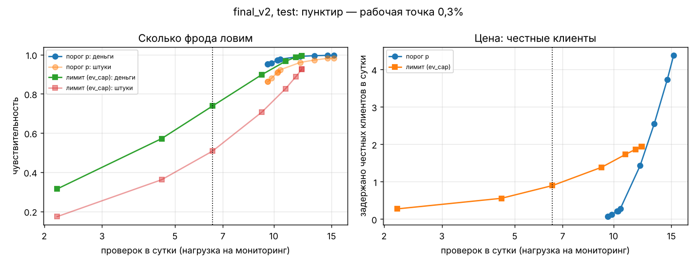
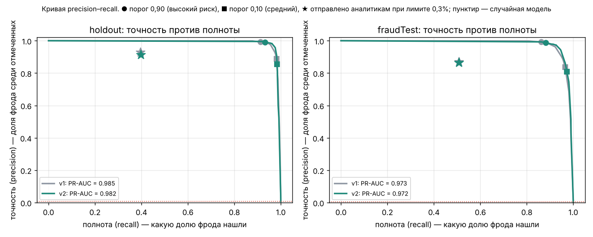

# Чувствительность и специфичность

Чувствительность — какая доля мошенничества поймана. Считаем её в штуках и в деньгах.

Специфичность — какая доля честных операций не задержана.

Обе величины приведены как функции порога, для каждой точки указана нагрузка на мониторинг. Таблицы и графики лежат в `tables/sens_spec_*.md/.csv/.png`. Скрипт: `python -m experiments.w2_sens_spec`.

У банка две «ручки», которыми он может управлять:

- **A. Порог по вероятности без лимита.** «Проверяем всё, где вероятность мошенничества ≥ t». Нагрузка получается какая получится.
- **B. Лимит аналитиков.** Так работает наша система: каждый день проверяем k = 0,3% операций с наибольшей ожидаемой выгодой. Порог при этом плавающий, на каждый день свой.

## A. Порог по вероятности — v1, holdout (своя оценка, 61 день, 0,63% фрода)

| порог p | проверок в сутки | задержано честных в сутки | чувствит., шт | чувствит., деньги | специфичность | точность | экономия, у.е. |
|---|---|---|---|---|---|---|---|
| ≥ 0,01 | 25,5 | 10,08 | 99% | 100% | 99,590% | 60% | 491 449 |
| ≥ 0,05 | 17,2 | 1,95 | 98% | 100% | 99,921% | 89% | 505 018 |
| ≥ 0,2 | 16,3 | 1,20 | 97% | 100% | 99,951% | 93% | 506 129 |
| ≥ 0,5 | 15,2 | 0,38 | 96% | 99% | 99,985% | 98% | 505 456 |
| ≥ 0,7 | 14,8 | 0,20 | 94% | 99% | 99,992% | 99% | 502 940 |
| ≥ 0,9 | 14,3 | 0,11 | 91% | 96% | 99,995% | 99% | 492 209 |
| ≥ 0,99 | 13,7 | 0,02 | 88% | 95% | 99,999% | 100% | 485 225 |

## B. Лимит аналитиков (политика ev_cap)

**v1, holdout:**

| лимит | проверок в сутки | задержано честных в сутки | чувствит., шт | чувствит., деньги | специфичность | точность | экономия, у.е. | упущено, у.е. |
|---|---|---|---|---|---|---|---|---|
| 0,10% | 2,0 | 0,03 | 12% | 23% | 99,999% | 98% | 118 622 | 390 045 |
| 0,20% | 4,4 | 0,18 | 27% | 46% | 99,993% | 96% | 236 049 | 272 642 |
| **0,30%** | **6,7** | **0,49** | **40%** | **64%** | **99,980%** | **93%** | **323 389** | **185 012** |
| 0,50% | 10,2 | 0,80 | 60% | 85% | 99,967% | 92% | 431 451 | 76 811 |
| 0,75% | 13,5 | 1,15 | 79% | 96% | 99,953% | 91% | 485 872 | 22 161 |
| 1,00% | 15,1 | 1,39 | 88% | 98% | 99,943% | 91% | 499 733 | 8 052 |
| 1,50% | 16,1 | 1,51 | 94% | 99% | 99,939% | 91% | 504 933 | 2 764 |

**v2, приёмка (fraudTest, 194 дня, 0,39% фрода):**

| лимит | проверок в сутки | задержано честных в сутки | чувствит., шт | чувствит., деньги | специфичность | точность | экономия, у.е. | упущено, у.е. |
|---|---|---|---|---|---|---|---|---|
| 0,10% | 2,2 | 0,27 | 17% | 31% | 99,990% | 88% | 355 983 | 776 602 |
| 0,20% | 4,6 | 0,56 | 36% | 57% | 99,980% | 88% | 646 364 | 485 488 |
| **0,30%** | **6,5** | **0,90** | **51%** | **74%** | **99,969%** | **86%** | **833 947** | **296 686** |
| 0,50% | 9,2 | 1,39 | 71% | 90% | 99,951% | 85% | 1 013 314 | 115 511 |
| 0,75% | 10,9 | 1,73 | 83% | 97% | 99,939% | 84% | 1 089 133 | 38 356 |
| 1,00% | 11,7 | 1,87 | 89% | 99% | 99,935% | 84% | 1 112 351 | 14 640 |

## Рабочая точка и её обоснование

**Рабочая точка — лимит 0,3% и политика ev_cap.** На приёмке v2 даёт такие числа:

- 6,5 проверок в сутки;
- 0,9 задержанного честного клиента в сутки;
- чувствительность 51% по штукам и 74% по деньгам;
- специфичность 99,969%;
- 98,0% от лучшего возможного при этом лимите.

Почему такая точка:

1. **Лимит 0,3% задал заказчик** — это сколько проверок в день может сделать мониторинг (≈ 7 проверок, а не 7 человек). Сами мы его не выбирали.
2. **Внутри лимита порог по деньгам лучше любого порога по вероятности.** Порог по p в таблице A не знает, сколько проверок может сделать банк: в одни дни он требует 25 проверок, в другие — 5.
3. **Выбор устойчив к нашим допущениям о ценах.** Мы меняли цену задержки честного клиента от 10 до 100 у.е. Экономия на holdout изменилась в пределах 0,4% (от 323 670 до 322 397). Ложных проверок при этом от 43 до 18. Решение определяют суммы фрода, а не наши допущения.

## Цена компромисса

Рост чувствительности возможен всегда. Ниже — что он стоит.

| Переход | + проверок в сутки | + задержанных честных в месяц | + спасено в месяц, у.е. (приёмка) | Цена 1 доп. проверки, у.е. спасённого |
|---|---|---|---|---|
| 0,3% → 0,5% | +2,7 | +15 | +28 000 | ≈ 340 |
| 0,5% → 0,75% | +1,7 | +10 | +11 900 | ≈ 230 |
| 0,75% → 1,0% | +0,8 | +4 | +3 600 | ≈ 150 |
| 1,0% → 1,5% | +0,4 | +2 | +1 300 | ≈ 110 |

Проверка стоит банку 3 у.е. Каждая дополнительная проверка до уровня 0,75–1% спасает в десятки раз больше. Значит, **ограничение — это люди, а не деньги**.

Клиентский опыт: при лимите 0,75% задерживается примерно 53 честных клиента в месяц вместо 27 при 0,3%. Это два звонка в день вместо одного.

## Кто решает и в какой форме

Рабочую точку выбирает **руководитель мониторинга вместе с владельцем риск-аппетита** (риск-менеджмент). Команда модели только готовит варианты.

Форма для решения — одна таблица на страницу, без ROC-кривых и без слова «специфичность»:

| Проверок в день | Сколько мошенничества по деньгам останавливаем | Сколько теряем в месяц | Сколько честных клиентов в месяц получат звонок |
|---|---|---|---|
| как сейчас, лимит 0,3% (≈ 6–7) | 74% | ≈ 46 тыс. у.е. | ≈ 27 |
| лимит 0,5% (≈ 9) | 90% | ≈ 18 тыс. у.е. | ≈ 42 |
| лимит 0,75% (≈ 11) | 97% | ≈ 6 тыс. у.е. | ≈ 53 |

Цифры — по приёмочному периоду с v2, в месяц ≈ 194/6,4 дня. Сколько людей нужно на эти проверки, знает только банк: это зависит от времени на одну проверку.

**Наша рекомендация: 0,5–0,75%.** Дальше выигрыш в деньгах маленький.

## Интерпретация при доле мошенничества ниже 1%

**Специфичность 99,7% или 99,97% почти ничего не говорит о модели.**

- Честных операций 99,6%, а проверять можно не больше 0,3% всех операций. Значит, даже если **все** проверки окажутся честными, специфичность не опустится ниже 1 − 0,003/0,996 ≈ **99,7%**.
- Столько же даст и случайный выбор 0,3% операций.
- Число 99,7% — это «пол», который обеспечивает сам лимит.

Чего специфичность не говорит: сколько мошенничества поймано, какая доля тревог ложная, сколько денег спасено.

Что она даёт, если перевести её в штуки: у нас 99,969% — это 0,9 задержанного честного клиента в сутки из ≈ 2 850. **Говорить заказчику нужно эти штуки, а не проценты.**

**Чувствительность от доли фрода формально не зависит**: она считается только по мошенническим операциям. Но при фиксированном лимите у неё есть потолок — мест в лимите меньше, чем мошеннических операций.

| | Мест в лимите | Фрод-операций | Максимально возможная чувствительность, шт | Наша |
|---|---|---|---|---|
| holdout | 427 | 948 | 41% | 40% |
| приёмка | 1 574 | 2 145 | 54% | 51% |

Поэтому чувствительность 40% в штуках — это не «модель ловит 40%», а «лимит позволяет поймать не больше 41%». Информативна чувствительность **в деньгах** и **относительно потолка**. Мы выбрали метрику «доля от лучшего возможного при лимите» ещё на неделе 1: 98,0% на приёмке.

**Почему показываем ещё точность, PR-AUC и деньги.** Точность (86–93%) и число задержанных в сутки прямо отвечают на вопрос «сколько звонков честным». PR-AUC не раздувается за счёт миллионов честных операций, в отличие от ROC-AUC. Для сравнения: ROC-AUC v1 на приёмке 0,995, хотя модель там хуже, чем на holdout.

## Группы риска и кривая precision–recall (замечания А1, А4, А5)

Помимо порога и лимита операции делятся на три группы по вероятности: **высокий** (p ≥ 0,90), **средний** (0,10–0,90), **низкий** (p < 0,10). Пороги групп — это две точки на кривой precision–recall.

| fraudTest, v2 | Операций | Из них фрод | Доля фрода в группе | Доля от всего фрода | Отправлено аналитику |
|---|---|---|---|---|---|
| высокий | 1 912 | 1 889 | 98,8% | 88,1% | 1 078 |
| средний | 668 | 197 | 29,5% | 9,2% | 149 |
| низкий | 553 139 | 59 | 0,01% | 2,8% | 37 |

Рисковых (высокий + средний) — 13,3 в день, а проверок — 6,5. Рабочая точка («★» на графике) лежит левее кривой: при этой точности модель могла бы найти 97% фрода, если бы мест хватало. PR-AUC при доле фрода 0,39% равен 0,972, у случайной модели — 0,004.
